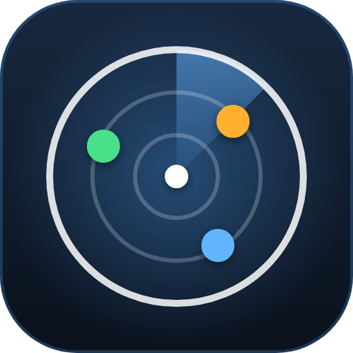

<p align="center"></p>

# MiniRadar | plugin Dalamud

Affiche sur la minimap de Final Fantasy XIV un petit point pour chaque joueur détecté autour de toi, avec une couleur pour tes amis, une pour ta compagnie et une pour les autres. Tout se règle.

## Installation en jeu

1. En jeu, tape `/xlsettings` → onglet **Experimental**.
2. Dans **Custom Plugin Repositories**, colle ce lien, coche **Enabled**, clique sur **+** puis **Save** :
   ```
   https://raw.githubusercontent.com/Powerl3ss/MiniRadar/main/repo.json
   ```
3. Tape `/xlplugins`, cherche **MiniRadar** et installe-le.

## Fonctionnalités

**Les points**
- Cinq catégories : amis, compagnie, groupe, alliance, autres joueurs. Le groupe et l'alliance sont désactivés au départ, car le jeu les affiche déjà.
- Pour chaque catégorie : affichée ou non, couleur et transparence, taille, forme (rond, losange, carré, triangle), contour, nom à côté du point.
- Un joueur n'a qu'une catégorie : un ami de ta compagnie reste un ami. Si les amis sont masqués, il prend la couleur de la compagnie.
- Les amis passent au-dessus de la compagnie, et la compagnie au-dessus de la foule.
- Au survol : le nom et la distance du joueur.

**La minimap**
- Les points suivent la rotation, le zoom, l'échelle de la carte et la taille de la minimap dans la disposition de l'interface.
- Minimap ronde ou carrée, pour ceux qui ont changé sa forme avec un autre plugin.
- Joueurs hors de la minimap : ramenés sur le bord (plus transparents), ou masqués.
- Distance maximale réglable.
- Les points apparaissent aussi sur la grande carte, quand elle montre la zone où tu te trouves, avec une taille réglable. Ils suivent le zoom, le déplacement de la carte et sa transparence.
- Masquage automatique en combat ou en instance. Désactivé en JcJ, sans réglage.
- Aperçu avec de faux joueurs, pour régler les couleurs sans personne autour de toi.
- Repère et décalages de calibrage, si les points ne tombent pas juste.

**Les réglages**
- Accueil : nombre de joueurs par catégorie, radar en grand avec le nord en haut, liste de tes proches avec leur distance.
- Diagnostic de la minimap dans la page À propos.

## Ce que le plugin voit

Seulement les joueurs que ton jeu a chargés autour de toi, pas toute la zone. Le plugin n'envoie rien et n'enregistre rien sur les joueurs croisés.

Le jeu ne donne pas l'identifiant de la compagnie des autres joueurs : un membre de ta compagnie est reconnu par le même sigle et le même monde d'origine. Une autre compagnie de ton monde qui aurait le même sigle serait confondue avec la tienne.

Les points sont dessinés par-dessus l'interface du jeu : une fenêtre du jeu ouverte sur la minimap ne les cache pas. Seule exception : les points de la minimap sont masqués là où la grande carte la recouvre.

Sur la grande carte, les joueurs sont placés à partir de l'icône de ton personnage, comme le font d'autres plugins qui dessinent sur cette carte.

## Commandes

| Commande | Effet |
|---|---|
| `/radar` | Affiche / masque les points sur la minimap |
| `/radar config` | Ouvre les réglages |
| `/radar debug` | Affiche l'état de la minimap dans le chat |

`/miniradar` fonctionne aussi, si `/radar` est déjà pris par un autre plugin.

## Si les points sont décalés

Ouvre `/radar config` → **Affichage** → **Calibrage**. Active le repère : la croix doit tomber sur ton personnage et la ligne sur le bord de la carte. Avec une minimap carrée, choisis d'abord **Carrée** dans **Affichage → Minimap et portée** : sa taille est lue dans le jeu, et le curseur **Taille du carré** permet de la corriger. Pour vérifier les positions, active la catégorie **Groupe** avec une autre personne : son point doit tomber sur l'icône du jeu.

## Crédits

Le calcul de la position sur la minimap reprend la méthode de [MiniMappingway](https://github.com/jaycewhite/MiniMappingway) (jaycewhite, licence MIT).

## Structure

```
MiniRadar/
├── Plugin.cs              point d'entrée : services, /radar, mise à jour à chaque image
├── Configuration.cs       réglages sauvegardés
├── Core/
│   └── Radar.cs           logique sans dépendance au jeu (testée à part) : catégories, position sur la minimap
├── Radar/
│   ├── MinimapReader.cs   lit la minimap du jeu : position, échelle, zoom, rotation
│   ├── AreaMapReader.cs   lit la grande carte : ton icône, le zoom, la zone visible
│   └── PlayerScanner.cs   parcourt les joueurs et les range par catégorie
├── images/                logo
└── Windows/
    ├── MinimapOverlay.cs  dessine les points et l'infobulle
    └── ConfigWindow*.cs   les réglages (même base que DailyToDo et DPSmeter)
Tests/MiniRadar.Tests/     tests de la logique : dotnet run depuis ce dossier
```
